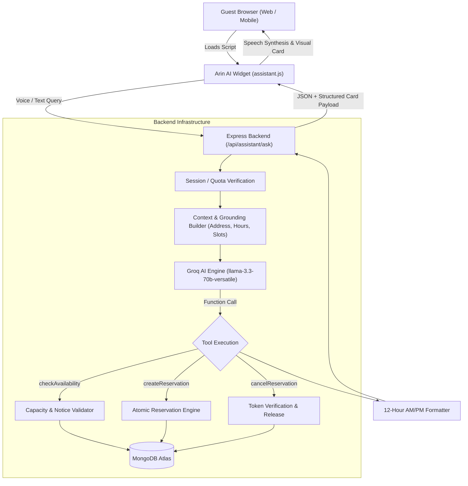

# Arin AI — Autonomous Voice & Reservation AI Platform

<p align="center">
  🚀 <strong>Deploying Soon</strong> — <strong><a href="https://x.com/AamirHussainOOP/status/2115116330068410390">checkout project demo here</a></strong>
</p>

<p align="center">
  <strong>Transform your website with an intelligent, voice-enabled AI concierge that answers customer inquiries, navigates pages, and books table reservations in real time.</strong>
</p>

<p align="center">
  
  
  
  
  
  
</p>

---

## 🌟 Overview

**Arin AI** is a production-ready conversational AI platform designed for hospitality, dining, and service-based businesses. It provides an all-in-one suite to build, personalize, and embed a high-performance conversational assistant on any website with a single `<script>` tag.

Built with sub-300ms latency powered by **Groq** function-calling models and integrated with native **Web Speech APIs**, Arin AI acts as an autonomous digital front desk: greeting visitors, detailing menus and amenities, answering address/operating hours inquiries, and executing verified reservations without human intervention.

---

## ✨ Key Features

### 🎙️ 1. Ultra-Low Latency Conversational Voice AI
- **Sub-300ms Inference**: Powered by Groq's `llama-3.3-70b-versatile` engine with OpenAI-compatible tool/function calling.
- **Bi-Directional Voice Interaction**: Native browser mic speech recognition coupled with natural speech synthesis.
- **Interactive Chat Stream Cards**: Live interactive chips for available slots and visual booking confirmation vouchers.
- **Intelligent Page Navigation**: Automatically directs visitors across your website based on keywords and conversational context (e.g., *"Take me to reservations"*).

### 📅 2. Autonomous Reservation & Table Capacity Engine
- **12-Hour AM/PM Time Schedulers**: Configurable start/end slots in standard 12-hour format (e.g. `12:00 PM – 02:00 PM`, `08:00 PM – 09:00 PM`).
- **Atomic Capacity Tracking**: Prevents overbooking with MongoDB capacity reservation locks.
- **Two-Phase Booking Protocol**: Confirms guest name, phone, date, and party size before allocating seats.
- **Self-Service Cancellations**: Generates cryptographically secure cancellation tokens and instant cancellation flows.
- **Location & Schedule Grounding**: Grounded on restaurant address, operating days, and advance notice windows.

### 🎨 3. Warm Luxury Editorial Design System
- **Curated Aesthetics**: Bespoke typography pairings (Playfair Display, Plus Jakarta Sans) and warm espresso/cream color palettes (`#382017`, `#A34720`, `#FBF7F0`).
- **Multi-Theme Support**: Dynamic widget color profiles including **Warm Bistro**, **Midnight Dark**, **Forest Emerald**, and **Coral Sunset**.
- **Responsive Layout**: Designed for seamless desktop, tablet, and mobile viewing.

### 🔌 4. Zero-Dependency 1-Click Embed Snippet
Add your assistant to any external HTML or web application (Shopify, WordPress, Webflow, custom React/HTML) by adding a single line before `</body>`:

```html
<script 
  src="https://your-domain.com/assistant.js" 
  data-user-id="YOUR_BUSINESS_ID" 
  async>
</script>
```

### 🛡️ 5. Zero-Exposures Security Architecture
- **Private Server-Side Execution**: All LLM API keys (`GROQ_API_KEY`) remain strictly on the backend. No secrets are ever exposed to the client or browser network inspection.
- **Cookie-Based JWT Auth**: Secure, `httpOnly` authentication for business owners.
- **Sanitized Configurations**: User configuration endpoints explicitly strip sensitive fields (`-password -groqApiKey -geminiApiKey`).

---

## 🏛️ System Architecture



---

## 📁 Repository Structure

```
Mencia/
├── Client/                         # Frontend Application (React 19 + Vite)
│   ├── public/
│   │   ├── assistant.js            # Standalone embeddable widget script
│   │   ├── assistant.css           # Standalone widget styling & theme rules
│   │   └── test-embed.html         # Test sandbox for script embedding
│   ├── src/
│   │   ├── assets/                 # Curated editorial photography & branding
│   │   ├── Components/             # Reusable UI components & layouts
│   │   │   ├── AppLayout.jsx       # Authenticated business dashboard frame
│   │   │   ├── AssistantPreview.jsx# Real-time studio interactive preview
│   │   │   └── Navbar.jsx          # Editorial header & navigation
│   │   ├── pages/                  # Page route controllers
│   │   │   ├── Home.jsx            # Landing page with interactive hero
│   │   │   ├── Builder.jsx         # 4-step studio (Profile, Persona, Pages, Slots)
│   │   │   ├── Bookings.jsx        # Table reservations & guest log
│   │   │   ├── Billing.jsx         # Plan telemetry & usage limits (100 responses)
│   │   │   └── Login.jsx           # Google OAuth entry
│   │   └── utils/                  # Firebase auth helpers and API constants
│   ├── .env.example                # Frontend environment template
│   └── package.json
│
├── Server/                         # Backend Application (Node.js + Express 5)
│   ├── Configs/                    # DB connection, Groq & Gemini clients, tokens
│   ├── Controllers/                # User, Assistant, Booking, Auth controllers
│   ├── Models/                     # Mongoose schemas (User, Booking, SlotCapacity)
│   ├── Routes/                     # Express route declarations
│   ├── Services/                   # Core business logic
│   │   ├── booking.ai.js           # Groq function declarations & system prompts
│   │   └── booking.service.js      # Availability calculations & atomic booking
│   ├── Tests/                      # Integration & unit test suites
│   ├── .env.example                # Backend environment template
│   ├── index.js                    # Server entry point
│   └── package.json
│
├── design.md                       # Complete visual design specification
├── UI_REDESIGN_PLAN.md             # Execution blueprint for v3.0.0
└── README.md                       # Project documentation
```

---

## 🚀 Quickstart Guide

### Prerequisites
- **Node.js**: v18.0.0 or higher
- **npm** or **pnpm**
- **MongoDB Atlas** cluster URI
- **Groq API Key** ([Get free API key](https://console.groq.com/keys))

---

### 1. Clone the Repository
```bash
git clone https://github.com/AamirHussainoo7/mencia.git
cd mencia
```

---

### 2. Backend Setup (`Server/`)

```bash
cd Server
npm install
```

Create a `.env` file based on `.env.example`:
```env
PORT=8000
CLIENT_URL=http://localhost:5173
MONGODB_URL=mongodb+srv://<username>:<password>@cluster0.mongodb.net/mencia?retryWrites=true&w=majority
JWT_SECRET=your_super_secret_jwt_key

# Groq Cloud API (Recommended)
GROQ_API_KEY=gsk_your_groq_api_key_here
GROQ_MODEL=llama-3.3-70b-versatile
GROQ_FALLBACK_MODEL=llama-3.1-8b-instant

# Optional Razorpay configuration
RAZORPAY_KEY_ID=your_key_id
RAZORPAY_KEY_SECRET=your_key_secret
```

Start the backend development server:
```bash
npm run dev
```
The server will boot on `http://localhost:8000`.

---

### 3. Frontend Setup (`Client/`)

Open a second terminal window:
```bash
cd Client
npm install
```

Create a `.env` file based on `.env.example`:
```env
VITE_SERVER_URL=http://localhost:8000
VITE_FIREBASE_API_KEY=your_firebase_web_api_key
```

Start the frontend development server:
```bash
npm run dev
```
The client dashboard will be available at `http://localhost:5173`.

---

### 4. Running the Test Suite
The backend includes test coverage for atomic booking transactions, retry jitter policies, Groq tool executions, and security sanitization:

```bash
cd Server
npm test
```

---

## 🔌 Using the Embeddable Widget

1. Navigate to the **Builder** page (`/builder`) in your dashboard.
2. Complete your business setup:
   - **Step 1 (Basic Info)**: Business name, short description, and logo.
   - **Step 2 (AI Persona)**: Tone of voice, greeting demeanor, and theme color.
   - **Step 3 (Navigation Pages)**: Key site URLs and trigger keywords.
   - **Step 4 (Booking Settings)**: Address/location, operating hours, and 12-hour AM/PM reservation slots.
3. Click **Save Assistant**.
4. Copy your embed snippet from the dashboard header:
   ```html
   <script 
     src="http://localhost:5173/assistant.js" 
     data-user-id="YOUR_USER_ID" 
     async>
   </script>
   ```
5. Paste it into any external HTML document (see `Client/public/test-embed.html` for a working live example).

---

## 🔒 Security & Best Practices

- **Zero API Key Leakage**: API keys are strictly confined to the backend environment and never rendered in frontend props, bundles, or responses.
- **Rate & Quota Limiting**: Free-tier accounts include a verified **100 AI responses quota** tracked in MongoDB.
- **Idempotency Safeguards**: Prevent accidental double submissions on flaky client networks using unique booking tokens.
- **CORS Allowlisting**: Strict origin checks on all private business management endpoints.

---

## 📄 License

This project is licensed under the [ISC License](LICENSE).

---

<p align="center">
  Crafted with care by <strong><a href="https://github.com/AamirHussainoo7">Aamir Hussain</a></strong>
</p>
